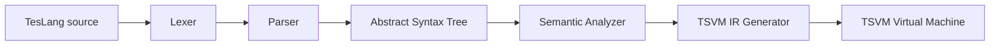

# TesLang Compiler

[](https://www.python.org/)
[](https://www.dabeaz.com/ply/)

An educational compiler pipeline for **TesLang**, a small statically checked programming language implemented in Python with [PLY](https://www.dabeaz.com/ply/).

The project covers the main stages of a compiler: lexical analysis, parsing, abstract syntax tree construction, semantic analysis, symbol-table management, and intermediate-code generation for the [TSVM](https://github.com/aligrudi/tsvm) virtual machine.

## Compiler Pipeline



## Project Highlights

- Lexer implemented with `PLY.lex`
- LALR parser implemented with `PLY.yacc`
- Explicit abstract syntax tree representation
- Hierarchical symbol tables and scoped name resolution
- Semantic checks for declarations, initialization, function calls, argument counts, and types
- Intermediate-code generation using a visitor-based backend
- Support for user-defined functions and selected built-in operations
- Example TesLang programs under `tests/`

## Language Features

### Front End

The lexer and parser include support for:

- Functions with typed parameters and return types
- Variable declarations and assignments
- Integer, vector, string, multiline-string, boolean, and null types
- Arithmetic and comparison expressions
- Logical `&&`, `||`, and `!` expressions
- Conditional expressions
- `if`/`else`, `while`, `do`/`while`, and `for` statements
- Function calls
- Vector indexing
- Single-line strings, multiline strings, and nested comments

### Built-in Operations

The project defines or recognizes the following built-ins:

- `scan()`
- `print(...)`
- `list(size)`
- `length(vector)`

## Example TesLang Program

```text
funk add(a as int, b as int) <int>
{
    result :: int = a + b;
    return result;
}

funk main() <null>
{
    a :: int;
    b :: int;

    a = scan();
    b = scan();

    print(add(a, b));

    return;
}
```

## Project Structure

```text
TesLang/
├── Lexer/
│   └── tokens.py
├── Parser/
│   ├── ast.py
│   ├── grammar.py
│   └── parser.py
├── SemanticAnalyzer/
│   ├── semantic_analyzer.py
│   ├── symtab.py
│   └── visitor.py
├── IR/
│   └── generator.py
├── tests/
│   ├── test_input.tes
│   └── test_input2.tes
├── main.py
├── requirements.txt
└── README.md
```

## Installation

### Prerequisites

- Python 3.10 or newer
- GCC, MinGW, or another C compiler for building TSVM

### Clone the Repository

```bash
git clone https://github.com/qazalnaderi/TesLang.git
cd TesLang
```

### Create a Virtual Environment

#### Windows PowerShell

```powershell
python -m venv .venv
.venv\Scripts\Activate.ps1
```

#### Linux or macOS

```bash
python3 -m venv .venv
source .venv/bin/activate
```

### Install Python Dependencies

```bash
pip install -r requirements.txt
```

## Building TSVM

### Windows with MinGW

```powershell
gcc -O2 tsvm.c -o tsvm.exe
```

### Linux or macOS

```bash
gcc -O2 tsvm.c -o tsvm
```

## Quick Start

Run the included compiler demonstration:

```bash
python main.py
```

The current entry point compiles `tests/test_input2.tes`, writes the generated intermediate representation to `output.ts`, and runs it using TSVM.

The bundled example reads two integers and prints their sum.

## Compiler Stages

### 1. Lexical Analysis

`Lexer/tokens.py` tokenizes TesLang source code, tracks line and column positions, handles strings, and removes nested comments while preserving source layout.

### 2. Parsing and AST Construction

`Parser/grammar.py` defines the language grammar and operator precedence. Parsing produces explicit AST nodes defined in `Parser/ast.py`.

### 3. Semantic Analysis

`SemanticAnalyzer/semantic_analyzer.py` uses a visitor-based traversal and hierarchical symbol tables to detect semantic errors such as:

- Undefined identifiers
- Duplicate declarations
- Use of uninitialized variables
- Invalid function calls
- Incorrect argument counts
- Type mismatches
- Invalid return values

### 4. Intermediate-Code Generation

`IR/generator.py` traverses the validated AST and generates intermediate instructions for the TSVM backend.

## Current Status

This repository is an **academic compiler project** rather than a production compiler.

The lexer, parser, AST, semantic analyzer, and integer-oriented demonstration form the core implemented pipeline. Some advanced backend paths—particularly vectors, strings, and complete TSVM instruction coverage—still require additional validation and automated tests.

## Roadmap

- Add a command-line interface for selecting source and output files
- Add unit tests for lexer, parser, semantic analysis, and code generation
- Complete and validate vector-memory operations
- Expand string and multiline-string code generation
- Improve source-position reporting
- Add continuous integration with GitHub Actions
- Add more valid and invalid TesLang example programs

## Academic Context

TesLang was developed as a compiler-design course project. The repository demonstrates practical experience with language design, compiler front ends, semantic analysis, visitor patterns, symbol tables, and virtual-machine-oriented code generation.

## Third-Party Component

`tsvm.c` is based on the [TSVM project by Ali Gholami Rudi](https://github.com/aligrudi/tsvm). Its original copyright and permission notice must remain intact.

